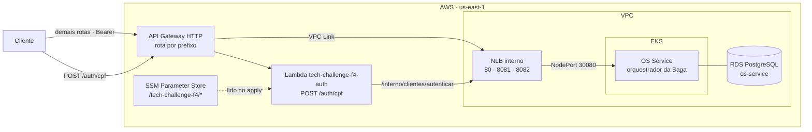
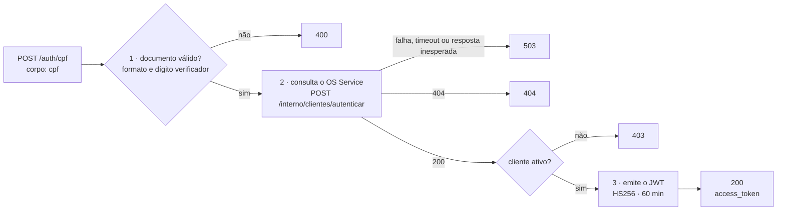
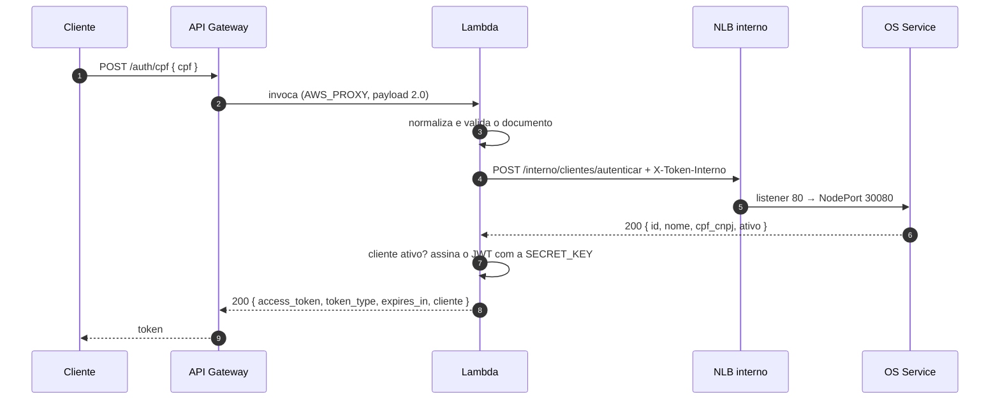

# tech-challenge-f4-auth-lambda

Função AWS Lambda `tech-challenge-f4-auth` que autentica o cliente da oficina pelo CPF (ou CNPJ) e emite o JWT
usado nas APIs protegidas. Valida o documento, consulta o OS Service pela rota interna e assina o token. **Não
acessa banco de dados.**

> Pós-Tech Software Architecture · FIAP · Tech Challenge Fase 04

[](https://sonarcloud.io/summary/new_code?id=pesant0s_tech-challenge-f4-auth-lambda)
[](https://sonarcloud.io/summary/new_code?id=pesant0s_tech-challenge-f4-auth-lambda)

| | |
|---|---|
| **Função** | `tech-challenge-f4-auth` |
| **Rota** | `POST /auth/cpf`, no API Gateway da plataforma |
| **Runtime** | AWS Lambda · Python 3.12 · 512 MB · timeout de 10 s |
| **Rede** | Subnets privadas da VPC, com saída só para o NLB interno (porta 80) |
| **Dependências** | `PyJWT` (a consulta ao OS Service usa só a biblioteca padrão) |
| **Testes** | 32, sem AWS, sem rede externa e sem banco |

## Sumário

1. [Os cinco repositórios](#1-os-cinco-repositórios)
2. [Visão geral do sistema](#2-visão-geral-do-sistema)
3. [Arquitetura do serviço](#3-arquitetura-do-serviço)
4. [Responsabilidades e limites](#4-responsabilidades-e-limites)
5. [Dados: nenhum banco, um contrato e um token](#5-dados-nenhum-banco-um-contrato-e-um-token)
6. [Mensageria e papel na Saga](#6-mensageria-e-papel-na-saga)
7. [API](#7-api)
8. [Configuração](#8-configuração)
9. [Como rodar localmente](#9-como-rodar-localmente)
10. [Testes e cobertura](#10-testes-e-cobertura)
11. [Pipeline CI/CD](#11-pipeline-cicd)
12. [Infraestrutura própria](#12-infraestrutura-própria)
13. [Deploy na AWS](#13-deploy-na-aws)
14. [Observabilidade](#14-observabilidade)
15. [Decisões](#15-decisões)
16. [Limites e limitações conhecidas](#16-limites-e-limitações-conhecidas)

---

## 1. Os cinco repositórios

A solução é a oficina mecânica da Fase 04: três microsserviços, uma função Lambda e uma plataforma de nuvem. Todos
na organização `pesant0s` do GitHub.

| Repositório | Papel |
|---|---|
| [plataforma](https://github.com/pesant0s/tech-challenge-f4-plataforma) | Terraform da base de nuvem (VPC, EKS, NLB, API Gateway, SSM, RabbitMQ, New Relic), contratos, ADRs, coleção Postman e ambiente local. **Suba primeiro** |
| [os-service](https://github.com/pesant0s/tech-challenge-f4-os-service) | Ordens de serviço, clientes, veículos e login de funcionário; orquestra a Saga. **Consultado por esta função** |
| [execucao-service](https://github.com/pesant0s/tech-challenge-f4-execucao-service) | Catálogo, estoque, fila de execução, diagnóstico e reparo |
| [billing-service](https://github.com/pesant0s/tech-challenge-f4-billing-service) | Orçamento, cobrança e reembolso no Mercado Pago |
| **auth-lambda** ← você está aqui | Autenticação do cliente por CPF e emissão do JWT. **Suba por último** |

---

## 2. Visão geral do sistema

Recorte do diagrama geral destacando esta função. O diagrama completo, as justificativas das tecnologias, a
Saga e a ordem de subida dos cinco repositórios estão no
[README da plataforma](https://github.com/pesant0s/tech-challenge-f4-plataforma#readme).



No API Gateway, a rota exata `POST /auth/cpf` vence a rota coringa `ANY /auth/{proxy+}` do OS Service: só essa
rota chega à Lambda, e todo o resto de `/auth/*` segue para o OS Service. A rota `/interno/*` do OS Service não
existe no gateway; esta função a alcança pelo NLB, dentro da VPC.

---

## 3. Arquitetura do serviço

A função é pequena e síncrona: um módulo por responsabilidade, sem camadas de framework.



A validação do documento acontece **antes** de qualquer chamada de rede: um documento malformado nem chega ao OS
Service (há teste garantindo isso).

| Módulo (`src/`) | Camada | Responsabilidade |
|---|---|---|
| `handler.py` | Adapter de entrada (evento do API Gateway) | Lê o corpo (inclusive em base64), orquestra os três passos, traduz cada resultado em status HTTP, monta a resposta e escreve os logs em JSON |
| `cpf.py` | Domínio | `normalizar()` valida CPF (11 dígitos) ou CNPJ (14) com os dígitos verificadores e devolve só os dígitos; `mascarar()` esconde o miolo para log |
| `os_service.py` | Adapter de saída (HTTP) | `buscar_cliente()` faz `POST /interno/clientes/autenticar` no OS Service e devolve um `Cliente` (`id`, `nome`, `cpf_cnpj`, `ativo`) ou `None` quando o OS Service responde 404 |
| `emissor.py` | Domínio | `emitir()` assina o JWT do cliente com PyJWT |

> O arquivo de emissão se chama `emissor.py`, e não `token.py`, para não colidir com o módulo `token` da
> biblioteca padrão do Python.

Sequência de uma autenticação bem-sucedida:



---

## 4. Responsabilidades e limites

**O que faz**

- Valida o CPF ou CNPJ (formato e dígitos verificadores).
- Pergunta ao OS Service se o cliente existe e se está ativo.
- Emite o JWT do cliente (HS256, 60 minutos por padrão).
- Registra logs JSON, sem nunca registrar o documento por inteiro.

**O que não faz**

- **Não acessa banco de dados.** Os clientes pertencem ao OS Service, e nenhum serviço acessa o banco de outro
  ([ADR-022](https://github.com/pesant0s/tech-challenge-f4-plataforma/blob/main/docs/adr/ADR-022-lambda-consulta-o-os-service.md)).
  Por isso a função não tem driver de banco, nem segredo de banco, nem o security group do banco.
- Não decide o que o cliente pode fazer: quem autoriza cada rota são as APIs, a partir do claim `tipo`.
- Não valida tokens: só os emite. A validação é das APIs, com a mesma `SECRET_KEY`.
- Não cadastra nem altera clientes, não guarda estado de login e não revoga token.
- Não publica nem consome mensagens.

**De quem é cada dado**

| Dado | Dono |
|---|---|
| Cliente (nome, CPF/CNPJ, situação ativo/inativo) | OS Service |
| `SECRET_KEY` e `TOKEN_INTERNO` | Plataforma (SSM), compartilhados com os serviços |
| JWT emitido | Ninguém guarda; é só assinado e devolvido |

---

## 5. Dados: nenhum banco, um contrato e um token

A função não tem modelo de dados. Ela depende de dois contratos.

### Rota interna do OS Service

`POST /interno/clientes/autenticar`, fora do API Gateway.

| | |
|---|---|
| Cabeçalho | `X-Token-Interno: <TOKEN_INTERNO>` (comparado em tempo constante pelo OS Service; sem o token configurado lá, a rota fica fechada) |
| Corpo | `{ "cpf_cnpj": "<só dígitos>" }` |
| `200` | `{ "id": "<uuid>", "nome": "...", "cpf_cnpj": "<dígitos>", "ativo": true }`. O OS Service responde também o cliente inativo: quem decide o acesso é a Lambda |
| `404` | Cliente não encontrado (a função devolve 404) |
| `403` e demais erros | Falha do OS Service: a função devolve 503 |

### O token

```json
{
  "sub": "3fa85f64-5717-4562-b3fc-2c963f66afa6",
  "tipo": "cliente",
  "cpf_cnpj": "52998224725",
  "nome": "João Silva",
  "iat": 1757437200,
  "exp": 1757440800
}
```

| Claim | Conteúdo |
|---|---|
| `sub` | Id do cliente no OS Service |
| `tipo` | Sempre `cliente`. É o que distingue este token do emitido por `POST /auth/token` (funcionário): um cliente enxerga só o que é seu, um funcionário opera a oficina |
| `cpf_cnpj` | Só dígitos |
| `nome` | Nome do cliente |
| `iat`, `exp` | Emissão e validade (`ACCESS_TOKEN_EXPIRE_MINUTES`, 60 por padrão) |

Algoritmo `HS256` (`ALGORITHM`).

> **A `SECRET_KEY` é compartilhada.** Esta função assina e as APIs validam. As duas leem do mesmo parâmetro do
> SSM (`/tech-challenge-f4/segredos/jwt_secret_key`), publicado pela plataforma. Se divergirem, todo token é
> rejeitado com erro genérico de credencial inválida: é o primeiro lugar a olhar quando a integração falha.

---

## 6. Mensageria e papel na Saga

A função **não participa da mensageria**: não publica comandos nem eventos e não consome filas.

Ela também não participa da Saga, mas é a porta de entrada do cliente: o token que ela emite é o que autoriza o
cliente a aprovar ou rejeitar o orçamento no Billing (`POST /billing/orcamentos/{os_id}/aprovar` e `/rejeitar`)
e a consultar as próprias ordens. A Saga (reserva de peças, orçamento, cobrança, fila e compensações) está no
[README da plataforma](https://github.com/pesant0s/tech-challenge-f4-plataforma#5-estratégia-da-saga).

---

## 7. API

A função não publica Swagger nem OpenAPI: é uma única rota. A coleção Postman da plataforma
([`docs/postman/`](https://github.com/pesant0s/tech-challenge-f4-plataforma/tree/main/docs/postman)) a exercita
nas pastas "1. Preparação" (token do cliente) e "5. Regras de acesso" (CPF inválido rejeitado).

| Método | Caminho | Perfil exigido | Descrição |
|---|---|---|---|
| `POST` | `/auth/cpf` | nenhum (rota pública) | Autentica por CPF ou CNPJ e devolve o JWT do cliente |

Só `POST`: o documento vai sempre no corpo, porque em query string ficaria gravado em histórico de navegador e
em log de proxy.

### Requisição

```bash
curl -X POST "$ENDPOINT/auth/cpf" \
  -H 'content-type: application/json' \
  -d '{"cpf":"529.982.247-25"}'
```

O valor de `cpf` pode ser CPF ou CNPJ, com ou sem pontuação (`.`, `-`, `/` e espaços). `ENDPOINT` é a URL do API
Gateway (`terraform output -raw url_api`, na plataforma, ou o parâmetro SSM `/tech-challenge-f4/apigateway/endpoint`).

### Resposta de sucesso (`200`)

```json
{
  "access_token": "eyJhbGciOiJIUzI1NiIs...",
  "token_type": "bearer",
  "expires_in": 3600,
  "cliente": { "id": "3fa85f64-...", "nome": "João Silva" }
}
```

`expires_in` está em segundos (`ACCESS_TOKEN_EXPIRE_MINUTES` × 60). A resposta leva o cabeçalho `x-request-id` com o
id da invocação da Lambda.

### Usar o token

```bash
curl "$ENDPOINT/atendimento/os" -H "Authorization: Bearer $TOKEN"
```

### Respostas

| Situação | Status | Corpo |
|---|---|---|
| Autenticado | `200` | token e dados do cliente |
| Corpo ausente, que não é JSON, sem `cpf`, com formato inválido, tamanho inválido ou dígito verificador errado | `400` | `{"detail": "..."}` (por exemplo, `Dígitos verificadores incorretos`) |
| Cliente não cadastrado | `404` | `{"detail": "Cliente não encontrado"}` |
| Cadastro inativo | `403` | `{"detail": "Cadastro inativo — procure a oficina"}` |
| OS Service indisponível, token interno recusado, tempo esgotado ou `OS_SERVICE_URL`/`TOKEN_INTERNO` ausentes | `503` | `{"detail": "Serviço temporariamente indisponível"}`, sem vazar endereço nem segredo |

---

## 8. Configuração

Variáveis de ambiente da função. O Terraform as define no `apply` (`infra/lambda.tf`).

| Variável | Padrão no código | Valor no deploy | Descrição |
|---|---|---|---|
| `OS_SERVICE_URL` | obrigatória | `http://<nlb/dns>:80` | Base da URL do OS Service, pelo NLB interno. A função acrescenta `/interno/clientes/autenticar` |
| `TOKEN_INTERNO` | obrigatória | parâmetro SSM `segredos/token_interno` | Enviado em `X-Token-Interno`; o OS Service compara com o dele |
| `SECRET_KEY` | obrigatória | parâmetro SSM `segredos/jwt_secret_key` | Chave que assina o JWT; precisa ser igual à das APIs |
| `ALGORITHM` | `HS256` | `HS256` | Algoritmo do JWT |
| `ACCESS_TOKEN_EXPIRE_MINUTES` | `60` | `60` | Validade do token, em minutos |
| `LOG_LEVEL` | `INFO` | `INFO` | Nível dos logs |

Variáveis do Terraform (`infra/variables.tf`):

| Variável | Padrão | Descrição |
|---|---|---|
| `regiao` | `us-east-1` | Região AWS |
| `perfil_aws` | `null` | Perfil local do AWS CLI; vazio no CI |
| `prefixo` | `tech-challenge-f4` | Prefixo dos nomes de recurso e do SSM; a função se chama `<prefixo>-auth` |
| `caminho_pacote` | `../dist/lambda.zip` | Zip produzido por `make build` |
| `memoria_mb` | `512` | Memória da função (na Lambda, a CPU acompanha a memória) |
| `timeout_segundos` | `10` | Timeout da função |

Há um modelo em `infra/terraform.tfvars.example`; o `terraform.tfvars` real não é versionado.

---

## 9. Como rodar localmente

### Alvos do Makefile

`make` sem argumento lista os alvos que têm descrição.

| Alvo | O que faz |
|---|---|
| `help` | Lista os alvos |
| `conta` | Mostra a conta AWS, o perfil e a região. Recusa sem `AWS_PROFILE` (ou credenciais no ambiente) |
| `venv` | Cria `.venv` e instala `requirements-dev.txt` |
| `test` | Roda os testes, sem AWS nem banco (cria o `.venv` se preciso) |
| `cov` | Roda os testes com cobertura (`--cov=src`, relatório no terminal e `coverage.xml`) |
| `build` | Limpa e monta `dist/lambda.zip`: copia `src/*.py`, instala as dependências de `requirements.txt` em `build/` e zipa. Use `PYTHON=python3.12 make build` para escolher o interpretador |
| `clean` | Remove `build/` e `dist/` |
| `init` | `terraform init` em `infra/`, com o bucket de estado e a região desta conta |
| `plan` | Empacota e mostra o que será alterado |
| `apply` | Confere o API Gateway, empacota e publica a função e a rota |
| `destroy` | Empacota (o Terraform lê o hash do zip até para destruir) e remove a função e a rota |
| `implantar` | Aciona o pipeline `ci-cd.yml` na `main` (`gh workflow run`), sem commit |
| `logs` | `aws logs tail /aws/lambda/tech-challenge-f4-auth --follow` |
| `invoke` | Testa a autenticação de ponta a ponta pelo API Gateway; `CPF=...` troca o documento (padrão `529.982.247-25`) |

O alvo `gateway`, interno (sem descrição), é dependência de `apply`: recusa se o parâmetro
`/tech-challenge-f4/apigateway/id` não existir, isto é, se a plataforma não estiver no ar.

### Rodar os testes

```bash
make venv     # ambiente virtual e dependências
make test     # 32 testes, sem AWS e sem banco
make cov      # com cobertura
```

O CI usa Python 3.12. O `make venv` usa o `python3` do `PATH`; escolha outro interpretador com `PYTHON=python3.12 make venv`.

### Chamar o handler sem AWS

O handler pode ser chamado direto, como faz o pipeline para validar o zip. Um CPF inválido responde 400 sem
precisar do OS Service:

```bash
cd src
SECRET_KEY=uma-chave-com-mais-de-32-caracteres python - <<'EOF'
import json, handler
resposta = handler.handler({"body": json.dumps({"cpf": "11111111111"})}, None)
print(resposta["statusCode"], resposta["body"])
EOF
```

Para uma autenticação completa, aponte a função para um OS Service em execução e use o mesmo `TOKEN_INTERNO`
dele:

```bash
cd src
SECRET_KEY=... TOKEN_INTERNO=... OS_SERVICE_URL=http://localhost:8000 python - <<'EOF'
import json, handler
resposta = handler.handler({"body": json.dumps({"cpf": "529.982.247-25"})}, None)
print(resposta["statusCode"], resposta["body"])
EOF
```

A `SECRET_KEY` precisa ser a mesma das APIs. O OS Service só abre a rota interna com `TOKEN_INTERNO` configurado.

### Ambiente integrado

O ambiente local da Saga (RabbitMQ, dois PostgreSQL e MongoDB) sobe com `make local-up` no
[repositório da plataforma](https://github.com/pesant0s/tech-challenge-f4-plataforma#12-ambiente-local). A função
não usa nenhum deles; ela só precisa alcançar o OS Service.

---

## 10. Testes e cobertura

**32 testes** em 4 arquivos (`python -m pytest --collect-only -q`), sem AWS, sem banco e sem rede externa. O OS
Service é substituído por um dublê em memória (no handler) ou por um servidor HTTP local de teste (no cliente).

| Arquivo | Testes | O que cobre |
|---|---|---|
| `tests/test_cpf.py` | 13 | CPF com e sem pontuação, CNPJ válido, dígitos verificadores errados, tamanho errado, caracteres inválidos, valor vazio e `None`, máscara de log que não expõe o documento |
| `tests/test_emissor.py` | 4 | Claims do token (identidade e `tipo = cliente`), expiração conforme o parâmetro, rejeição de assinatura com outra chave, rejeição de token expirado |
| `tests/test_handler.py` | 9 | `200` com token; CPF pontuado normalizado antes da consulta; CPF inválido não chega ao OS Service; documento ausente; corpo que não é JSON; cliente inexistente (404); cliente inativo (403); OS Service indisponível (503, sem vazar endereço nem segredo); `x-request-id` na resposta |
| `tests/test_os_service.py` | 6 | Chamada à rota interna com o caminho e o `X-Token-Interno` corretos; 404 vira `None`; 403, 500 e 503 do OS Service viram falha; OS Service fora do ar |

**Cobertura mínima de 80% no CI** (`--cov-fail-under=80`). Cobertura medida localmente: 98,98% (98 instruções,
1 não coberta: `src/handler.py`, linha 58, o ramo de corpo em base64).

SonarQube Cloud (projeto
[`pesant0s_tech-challenge-f4-auth-lambda`](https://sonarcloud.io/summary/new_code?id=pesant0s_tech-challenge-f4-auth-lambda)),
lido na API pública:

```bash
curl -s "https://sonarcloud.io/api/measures/component?component=pesant0s_tech-challenge-f4-auth-lambda&metricKeys=coverage,bugs,vulnerabilities,code_smells"
```

| Métrica | Valor |
|---|---|
| Cobertura | 99,0% |
| Bugs | 0 |
| Vulnerabilidades | 3 |
| Code smells | 0 |
| Quality Gate | aprovado |

As três vulnerabilidades abertas são alertas de configuração, não de código da função: instalação de
dependências no workflow sem `--only-binary` e sem versões travadas (`githubactions:S8541` e `S8544`, em
`ci-cd.yml`) e a retenção de 7 dias do grupo de logs (`terraform:S6413`, em `infra/lambda.tf`).

Configuração do SonarQube (`sonar-project.properties`): organização `pesant0s`, projeto
`pesant0s_tech-challenge-f4-auth-lambda`, Python 3.12, relatório de cobertura `coverage.xml`, `tests/**` fora da
conta de cobertura e de duplicação, e `sonar.qualitygate.wait=true` (o quality gate reprova o pipeline).

---

## 11. Pipeline CI/CD

Arquivo: [`.github/workflows/ci-cd.yml`](.github/workflows/ci-cd.yml).

| Item | Valor |
|---|---|
| Gatilhos | `push` e `pull_request` em `develop` e `main`; `workflow_dispatch` |
| Concorrência | grupo `<workflow>-<ref>`; só Pull Request cancela a execução anterior |
| Variáveis | `AWS_REGION=us-east-1`, `TF_VERSION=1.17.1`, `PREFIXO_SSM=/tech-challenge-f4` |
| Permissões | `contents: read` (o job `publicar` acrescenta `id-token: write`) |

| Job | Nome na tela | Depende de | Quando roda | O que faz |
|---|---|---|---|---|
| `testes` | Testes | — | sempre | Python 3.12, `pip install -r requirements-dev.txt`, `pytest --cov=src --cov-report=term-missing --cov-report=xml --cov-fail-under=80 -q`; publica `coverage.xml` como artefato `cobertura` |
| `qualidade` | Qualidade (SonarQube Cloud) | `testes` | sempre | Baixa a cobertura e roda o scan do SonarQube Cloud; o quality gate reprova o job |
| `empacotar` | Empacotar e validar o zip | — | sempre | `make build`, descompacta o zip em `/tmp/verifica` e importa o `handler` a partir da raiz do zip, como a Lambda faz; chama o handler com CPF inválido e exige `400`. Pega dependência ou arquivo faltando antes do deploy |
| `ambiente-desligado` | Publicação não executada | `testes`, `empacotar` | `push` ou execução manual na `main`, com `AMBIENTE_ATIVO` diferente de `true` | Escreve no resumo que a publicação foi pulada porque o ambiente AWS está desligado. Job pulado não é falha |
| `publicar` | Publicar na AWS | `testes`, `empacotar` | `push` ou execução manual na `main`, com `AMBIENTE_ATIVO=true` | Autentica na AWS, `make build`, `terraform apply` em `infra/` e teste de fumaça |

**Teste de fumaça.** Lê o endpoint do SSM (`/tech-challenge-f4/apigateway/endpoint`) e chama
`POST /auth/cpf` com o CPF inválido `11111111111`, até 6 vezes com 10 s de intervalo, esperando `400`. Um CPF
sabidamente inválido tem de voltar 400; um 5xx indica problema de VPC, segredo ou pacote.

**Checks obrigatórios da `main`:** `Testes`, `Empacotar e validar o zip` e `Qualidade (SonarQube Cloud)`. A `main`
só recebe código por Pull Request (inclusive para administradores).

**Autenticação na AWS.** Com o secret `AWS_ROLE_ARN`, assume a role por OIDC (conta comum). Sem ele, usa as
credenciais temporárias do AWS Academy (`AWS_ACCESS_KEY_ID`, `AWS_SECRET_ACCESS_KEY`, `AWS_SESSION_TOKEN`). O
Terraform usa o bucket `tech-challenge-f4-tfstate-<conta>`, descoberto por `aws sts get-caller-identity`.

**`AMBIENTE_ATIVO`.** O ambiente AWS é efêmero (ligado só em sessões de trabalho, porque o EKS cobra por hora).
`make up` na plataforma liga a variável nos cinco repositórios e `make down` a desliga. Desligada, os jobs que
precisam de AWS aparecem como pulados; testes, qualidade e empacotamento rodam sempre.

| Configuração no repositório | Tipo | Quem grava |
|---|---|---|
| `AMBIENTE_ATIVO` | variável | `make up` e `make down`, na plataforma |
| `AWS_ROLE_ARN` | secret | `make github-segredos`, na plataforma (conta comum) |
| `AWS_ACCESS_KEY_ID` · `AWS_SECRET_ACCESS_KEY` · `AWS_SESSION_TOKEN` | secrets | `make github-segredos`, na plataforma (laboratório) |
| `SONAR_TOKEN` | secret | à mão, no repositório |

---

## 12. Infraestrutura própria

Terraform em `infra/`. Estado remoto no bucket `tech-challenge-f4-tfstate-<conta>`, chave
`auth-lambda/terraform.tfstate` (com bloqueio nativo por arquivo, `use_lockfile`). `required_version >= 1.10`,
provider `aws ~> 5.60`. Tags em todo recurso: `Project = tech-challenge-f4`, `Fase = 04`,
`Repositorio = tech-challenge-f4-auth-lambda` e `ManagedBy = terraform`.

| Arquivo | Recursos |
|---|---|
| `lambda.tf` | Grupo de logs `/aws/lambda/tech-challenge-f4-auth` (retenção de 7 dias) e a função `tech-challenge-f4-auth`: `python3.12`, handler `handler.handler`, pacote `../dist/lambda.zip` (com `source_code_hash`), 512 MB, timeout de 10 s, nas subnets privadas, com as variáveis de ambiente da [seção 8](#8-configuração) |
| `apigateway.tf` | Integração `AWS_PROXY` (payload 2.0, timeout de 15 000 ms) na API da plataforma, rota `POST /auth/cpf` e a permissão `AllowAPIGatewayInvoke` para o gateway invocar a função |
| `rede.tf` | Security group `tech-challenge-f4-auth-funcao`: **saída só TCP 80 para o CIDR da VPC** (o NLB interno) |
| `iam.tf` | **No laboratório**, usa a role existente `LabRole` (o AWS Academy não permite criar roles). **Fora dele**, cria a role `tech-challenge-f4-auth-execucao` com `AWSLambdaVPCAccessExecutionRole` |
| `data_contrato.tf` | Leitura dos parâmetros do SSM publicados pela plataforma |
| `outputs.tf` | `nome_funcao`, `url_autenticacao` (`<endpoint>/auth/cpf`) e `grupo_de_logs` |

**Detecção do laboratório.** `data "aws_iam_roles"` procura a role `^LabRole$`. Se existir, a função usa `LabRole`;
se não, o Terraform cria a role de execução.

**Parâmetros SSM lidos** (todos sob `/tech-challenge-f4/`, publicados pela plataforma; ver o
[contrato de infraestrutura](https://github.com/pesant0s/tech-challenge-f4-plataforma/blob/main/docs/infraestrutura/contrato.md)):

| Parâmetro | Uso |
|---|---|
| `rede/vpc_id` | VPC do security group |
| `rede/cidr` | Destino da regra de saída |
| `rede/subnets_privadas` | Subnets da função |
| `nlb/dns` | Monta `OS_SERVICE_URL` |
| `apigateway/id` | API em que a rota é criada |
| `apigateway/execucao_arn` | ARN de execução, para a permissão da função |
| `apigateway/endpoint` | Saída `url_autenticacao` |
| `segredos/jwt_secret_key` (SecureString) | `SECRET_KEY` |
| `segredos/token_interno` (SecureString) | `TOKEN_INTERNO` |

A função **não escreve** nada no SSM. Sem NAT Gateway, a Lambda não alcança o SSM nem a internet: por isso o
Terraform lê os segredos no `apply` e os injeta como variáveis de ambiente ([ADR-010](#decisões-herdadas)).

Não há manifestos Kubernetes: a função roda no AWS Lambda, fora do cluster.

---

## 13. Deploy na AWS

Ordem de subida: **plataforma → serviços → Lambda**. A função lê o contrato da plataforma e chama o OS Service,
então precisa dos dois no ar. O `make apply` recusa se o API Gateway não existir.

```bash
export AWS_PROFILE=seu-perfil

make apply       # empacota, inicializa o estado desta conta e publica função e rota
make invoke      # testa de ponta a ponta (CPF=... para outro documento)
make logs        # acompanha as invocações
make implantar   # alternativa: aciona o pipeline na main, sem commit
```

A saída `url_autenticacao` mostra a URL pública da rota. Um cliente precisa estar cadastrado no OS Service para
`make invoke` devolver `200`; com um CPF válido não cadastrado, a resposta é `404`.

**Destruição, na ordem inversa:** esta função é a primeira a sair, antes dos serviços e da plataforma.

```bash
make destroy     # remove função, rota, permissão e security group
```

O `make down` da plataforma recusa enquanto a função existir.

A ordem completa de subida e destruição dos cinco repositórios está no
[README da plataforma](https://github.com/pesant0s/tech-challenge-f4-plataforma#10-subir-e-destruir-a-solução-inteira).

**Custo.** Lambda, CloudWatch Logs e API Gateway têm custo desprezível neste volume. Não há nada a desligar aqui
para evitar cobrança; o custo por hora do ambiente está no EKS da plataforma.

---

## 14. Observabilidade

- **Logs em JSON**, no CloudWatch Logs (`/aws/lambda/tech-challenge-f4-auth`, retenção de 7 dias), lidos com
  `make logs`. Cada linha tem `timestamp`, `level`, `logger` (`auth`), `message` e `request_id`, mais os campos
  extras de cada evento. O `request_id` é o id da invocação da Lambda, devolvido também no cabeçalho
  `x-request-id` da resposta.
- **O documento nunca é registrado por inteiro.** `mascarar()` reduz o CPF a `529***25` antes de qualquer log:
  dado pessoal sob a LGPD não deve ficar em log de aplicação.

```json
{"timestamp":"2026-11-16T13:54:00+00:00","level":"INFO","logger":"auth",
 "message":"Cliente autenticado","request_id":"abc-123",
 "cliente_id":"3fa85f64","documento":"529***25"}
```

| Evento | Nível | Mensagem |
|---|---|---|
| Documento inválido | `WARNING` | `Documento rejeitado: <motivo>` |
| Falha ao consultar o OS Service | `ERROR` | `Falha ao consultar o OS Service`, com a pilha em `exception` |
| Cliente inexistente | `INFO` | `Cliente não encontrado` |
| Cliente inativo | `WARNING` | `Cliente inativo tentou autenticar` |
| Sucesso | `INFO` | `Cliente autenticado` |

- **Métricas no New Relic** (invocações e erros), quando o New Relic está configurado na plataforma: a integração
  AWS lê o CloudWatch por polling a cada 5 minutos e alimenta o widget "Lambda de autenticação" do dashboard
  "Tech Challenge · Oficina". **No laboratório essa integração não existe** (exige uma role própria), então o
  widget fica vazio; os logs continuam no CloudWatch.
- **Elo com o gateway.** O access log do API Gateway e o log da função se ligam pelo `requestId` do gateway e o
  `request_id` da invocação.
- Os logs da função não vão ao New Relic; só as métricas.

---

## 15. Decisões

Decisões da fase, no repositório da plataforma
([`docs/adr/`](https://github.com/pesant0s/tech-challenge-f4-plataforma/tree/main/docs/adr)):

| Documento | Decisão |
|---|---|
| [ADR-017](https://github.com/pesant0s/tech-challenge-f4-plataforma/blob/main/docs/adr/ADR-017-divisao-em-microsservicos.md) | Divisão em três microsserviços: os clientes passam a ser do OS Service |
| [ADR-022](https://github.com/pesant0s/tech-challenge-f4-plataforma/blob/main/docs/adr/ADR-022-lambda-consulta-o-os-service.md) | A Lambda consulta o OS Service pela rota interna, e não o banco dele |
| [ADR-024](https://github.com/pesant0s/tech-challenge-f4-plataforma/blob/main/docs/adr/ADR-024-ambientes.md) | Ambientes: desenvolvimento local, CI e AWS; laboratório com `LabRole` |
| [RFC-003](docs/rfc/RFC-003-autenticacao.md) | Estratégia de autenticação: a Lambda emite um JWT HS256 e as APIs validam com um único mecanismo, separando os públicos pelo claim `tipo`. O trecho que fala em consultar o RDS foi substituído pelo ADR-022 |

### Decisões herdadas

Continuam valendo e aparecem nos comentários do Terraform e do código.

| ADR | Decisão |
|---|---|
| ADR-010 | **Segredo por variável de ambiente, não por consulta em execução.** A Lambda roda em subnet privada e não há NAT Gateway; sem rota para a internet, ela não alcançaria o SSM. Um VPC Endpoint de interface resolveria, a ~US$ 7/mês. O Terraform lê o segredo no `apply` e o injeta como variável de ambiente. Contrapartida: o valor consta no estado do Terraform, que vive num bucket S3 criptografado, versionado e com acesso público bloqueado; as variáveis de ambiente da Lambda também são cifradas em repouso |
| ADR-011 | **Validação de CPF duplicada, não compartilhada.** A regra é reimplementada aqui em vez de importada de uma biblioteca comum com o OS Service: o desafio exige repositórios independentes, e uma biblioteca compartilhada criaria acoplamento de build. A regra é estável e coberta por testes |
| ADR-012 | **A rota pertence a quem é dono da função.** A plataforma cria o API Gateway e a rota coringa; a rota `POST /auth/cpf` é criada por este repositório, que lê `apigateway/id` no SSM. No API Gateway HTTP, a rota explícita vence a coringa |

---

## 16. Limites e limitações conhecidas

### Limites

| Limite | Valor | Origem |
|---|---|---|
| Memória | 512 MB | `memoria_mb` |
| Timeout da função | 10 s | `timeout_segundos` |
| Timeout da chamada ao OS Service | 5 s | `os_service.py` (`urlopen(timeout=5)`) |
| Timeout da integração no API Gateway | 15 000 ms | `infra/apigateway.tf` |
| Limite de requisições do gateway | 50 por segundo, rajada de 100 (estágio inteiro, não só esta rota) | plataforma, `exposicao.tf` |
| Validade do token | 60 minutos | `ACCESS_TOKEN_EXPIRE_MINUTES` |
| Retenção dos logs | 7 dias | `infra/lambda.tf` |

**Concorrência.** A função não define concorrência reservada (`reserved_concurrent_executions` não é configurado
e `aws lambda get-function-concurrency` não retorna reserva): ela usa o limite de execuções simultâneas da
conta. Na conta do AWS Academy em que a solução foi validada, `aws lambda get-account-settings` informou
`ConcurrentExecutions: 400`. O limite do laboratório é da conta e pode variar; confira com o mesmo comando. Como
cada invocação dentro da VPC espera o OS Service responder, a vazão da autenticação também é limitada pelo OS
Service (2 a 4 réplicas, com HPA) e pelo limite de 50 requisições por segundo do gateway.

### Limitações

| Limitação | Efeito |
|---|---|
| Depende do OS Service no ar | Se ele não responder, a função devolve `503` (como devolvia quando o banco caía na Fase 03) |
| Segredos no estado do Terraform | `SECRET_KEY` e `TOKEN_INTERNO` constam no estado (bucket S3 criptografado, versionado e com acesso público bloqueado), consequência do [ADR-010](#decisões-herdadas). Trocar a chave exige republicar a função e os serviços |
| Segredo compartilhado | Quem tem a `SECRET_KEY` assina tokens de qualquer cliente |
| Sem revogação de token | A função só emite; o token vale até expirar. O OS Service confere se o cadastro continua ativo a cada requisição de cliente (`security.py`), mas o Billing valida só os claims do token |
| Tráfego interno em HTTP | A chamada da função ao NLB interno é HTTP na porta 80, dentro da VPC, protegida pelo security group (saída só para o CIDR da VPC) e pelo `X-Token-Interno` |
| Credenciais do laboratório expiram | O job `Publicar na AWS` usa credenciais temporárias; se a `publicar` falhar na autenticação, rode `make github-segredos` na plataforma |
| Versão do Terraform no pipeline | O workflow fixa `TF_VERSION=1.17.1`; um estado gravado por Terraform mais novo só é lido por versão igual ou superior (ver as limitações no README da plataforma) |
| Alertas do SonarQube Cloud | 3 vulnerabilidades abertas, de configuração (seção 10) |

---

## Estrutura do repositório

```
.
├── src/
│   ├── handler.py             entrada da Lambda: orquestra os três passos
│   ├── cpf.py                 validação de CPF/CNPJ e máscara para log
│   ├── os_service.py          consulta ao OS Service (rota interna)
│   ├── emissor.py             emissão do JWT
│   └── __init__.py
├── tests/                     32 testes, sem AWS nem banco
├── infra/                     Terraform: função, rede, IAM e rota no gateway
├── docs/rfc/RFC-003-autenticacao.md
├── .github/workflows/ci-cd.yml
├── Makefile
├── requirements.txt           PyJWT
├── requirements-dev.txt       pytest e pytest-cov
└── sonar-project.properties
```
